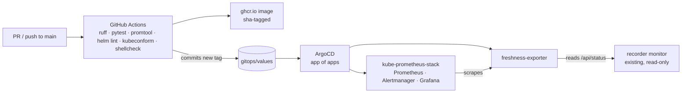

# market-data-gitops

GitOps platform for observing a live market-data recorder: a Kubernetes cluster, a Python
exporter, a Helm chart, ArgoCD, GitHub Actions CI, and a tested SLO with an error budget.

The recorder it watches is a production system I run on my own rack: it streams live index,
futures and options quotes over WebSocket into PostgreSQL/TimescaleDB around the clock. That
system lives in its own (private) repositories. This repo is the platform layer around it, built
in the open.

## What's here



| Path | What it is |
|---|---|
| `apps/freshness-exporter/` | Python Prometheus exporter. Reads the recorder monitor's `/api/status` on each scrape and exports per-stream age, rows/min and state, recorder up/restarts, and an RTH flag. 12 unit tests. |
| `charts/freshness-exporter/` | Helm chart: Deployment (non-root, read-only root FS), Service, ServiceMonitor, PrometheusRule, Grafana dashboard. |
| `charts/freshness-exporter/rules/` | SLO recording rules and multiwindow burn-rate alerts, unit-tested with `promtool test rules`. |
| `gitops/` | ArgoCD app of apps, the Applications, and per-environment values. CI writes the image tag here; ArgoCD does the deploy. |
| `apps/delivery-metrics/` | DORA metrics (deploy frequency, lead time, change failure rate, time to restore) from this repo's own commits and CI runs. |
| `terraform/github/` | Repository settings, the `main` ruleset and the CI deploy key as code. |
| `cluster/` | k3d cluster config, pinned tool versions, checksum-verified tool install, bootstrap and teardown. |
| `docs/dr/` | Disaster-recovery objectives and drill results. |
| `docs/adr/` | Architecture decision records. Start with [0001](docs/adr/0001-record-architecture-decisions.md). |
| `docs/runbooks/` | What to do when an alert fires. |

## The SLO

> During US regular trading hours, the SPX stream's last event is under 60 seconds old for
> **99.5%** of 30-second evaluations over a rolling 30 days.

That is about 41 minutes of budget per 30 days (~21 sessions × 390 RTH minutes × 0.5%). An unreachable monitor
counts as bad, and time outside RTH (the weekend stop, the daily CME halt) is excluded. Alerts are
multiwindow burn rates (14.4x over 1 h + 5 m pages, 6x over 6 h + 30 m opens a ticket), so they
fire on user impact, not on a single slow scrape. Reasoning in
[ADR 0004](docs/adr/0004-recorder-freshness-slo.md).

## Path to production

1. Open a PR (direct pushes to `main` are blocked by the Terraform-managed ruleset). CI runs lint,
   unit tests, rule tests, chart lint and render, schema validation, shellcheck and `terraform validate`; all are required.
2. Merge to `main`. CI builds the image, pushes `ghcr.io/plewis22782/freshness-exporter:sha-<commit>`,
   and commits that tag to `gitops/values/freshness-exporter.yaml`.
3. ArgoCD sees the commit and syncs. CI never holds cluster credentials.
4. Rollback is `git revert` of the tag commit. ArgoCD syncs the previous image.

## Run it

```bash
cluster/install-tools.sh     # k3d, kubectl, helm into ~/.local/bin, sha256-verified
cluster/bootstrap.sh         # cluster + ArgoCD; everything else comes from git
```

ArgoCD on `:8441` (HTTPS), Grafana on `:8442`, Prometheus on `:8443` of the host. Admin passwords are generated in-cluster; `bootstrap.sh` prints how to read them. `cluster/teardown.sh`
removes everything. Nothing outside the cluster is touched ([ADR 0002](docs/adr/0002-k3d-on-the-existing-docker-host.md)).

## Roadmap

- [x] Disaster-recovery drills: rebuild from git timed against RTO/RPO ([docs/dr/drills.md](docs/dr/drills.md)). Drill 1 met the RTO (5 min) but failed the RPO, which led to ADR 0006; drill 2 met both (7 min, no history lost).
- [x] Delivery (DORA) metrics from git history: `apps/delivery-metrics`, ADR 0007.
- [x] Terraform for the GitHub side: settings, `main` ruleset, CI deploy key. `terraform/github`, ADR 0008.
- [ ] Alertmanager routing to a real receiver.
- [ ] Exchange holiday calendar for the RTH flag (today a holiday counts as RTH; see ADR 0004).
- [ ] Second SLO for option-contract coverage, not just the index stream.
